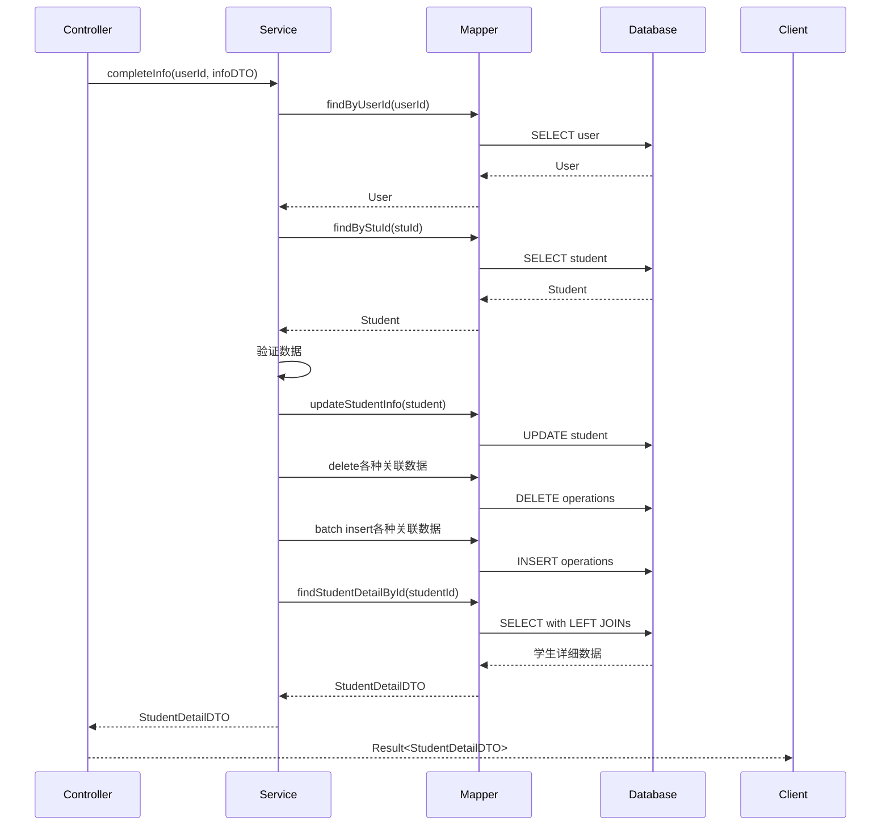

# 学生完善信息接口返回详细信息 - 实现说明

## 需求说明

学生完善信息接口修改为返回学生详细信息，包括所有关联表的数据，方便前端直接展示完整的学生档案。

## 实现方案

### 1. 数据结构设计

使用现有的 `StudentDetailDTO` 作为返回类型，包含以下信息：

```java
public class StudentDetailDTO {
    // 基本信息
    private Integer id;
    private Integer stuId;
    private String name;
    private Integer age;
    private String gender;
    private String nation;
    private String major;
    private String degree;
    private Integer graduationYear;
    private Integer internship;
    
    // 关联信息
    private List<LanguageDTO> languages;          // 语言证书列表
    private List<CertificateDTO> certificates;    // 专业证书列表
    private List<InternshipDTO> internships;      // 实习经历列表
    private List<JobDTO> jobs;                    // 求职意向列表
    private List<SpecialityDTO> specialities;     // 专业技能列表
    private RegionDTO region;                     // 地区信息
    private ResumeDTO resume;                     // 简历信息
}
```

### 2. 修改的文件

#### 2.1 StudentInfoMapper.java
**路径**: `src/main/java/com/resume/student/mapper/StudentInfoMapper.java`

**修改内容**:
```java
// 添加导入
import com.resume.model.dto.StudentDetailDTO;

// 新增方法
/**
 * 根据学生ID查询学生详细信息（包含所有关联数据）
 * @param studentId 学生主键ID
 * @return 学生详细信息
 */
StudentDetailDTO findStudentDetailById(@Param("studentId") Integer studentId);
```

#### 2.2 StudentInfoMapper.xml（新建）
**路径**: `src/main/resources/mapper/StudentInfoMapper.xml`

**核心逻辑**:
- 使用 `LEFT JOIN` 关联所有相关表
- 使用 `ResultMap` 映射复杂的嵌套结构
- 使用 `collection` 映射一对多关系（语言、证书、实习等）
- 使用 `association` 映射一对一关系（地区、简历）
- 使用 `GROUP_CONCAT` 合并地区信息
- 使用子查询获取最新的简历记录

**关键SQL片段**:
```sql
SELECT 
    s.id, s.stu_id, s.name, s.age, s.gender, s.nation, s.major, s.degree,
    s.graduation_year, s.internship,
    
    -- 语言信息
    sl.language AS lang_language,
    sl.level AS lang_level,
    
    -- 证书信息
    sc.cert_name AS cert_name,
    sc.level AS cert_level,
    
    -- 实习信息
    si.company AS intern_company,
    si.experience AS intern_experience,
    
    -- 求职意向
    sj.post AS job_post,
    
    -- 专业技能
    ss.speciality AS spec_speciality,
    
    -- 地区信息（合并）
    GROUP_CONCAT(DISTINCT sr.province) AS region_province,
    GROUP_CONCAT(DISTINCT sr.city) AS region_city,
    
    -- 最新简历
    sr2.resume AS resume_url
    
FROM student s
LEFT JOIN stu_language sl ON s.id = sl.stu_id
LEFT JOIN stu_certificate sc ON s.id = sc.stu_id
LEFT JOIN stu_internship si ON s.id = si.stu_id
LEFT JOIN stu_job sj ON s.id = sj.stu_id
LEFT JOIN stu_speciality ss ON s.id = ss.stu_id
LEFT JOIN stu_region sr ON s.id = sr.stu_id
LEFT JOIN (
    SELECT stu_id, resume 
    FROM stu_resume 
    WHERE id IN (SELECT MAX(id) FROM stu_resume GROUP BY stu_id)
) sr2 ON s.id = sr2.stu_id
WHERE s.id = #{studentId}
GROUP BY ...
```

#### 2.3 StudentInfoService.java
**路径**: `src/main/java/com/resume/student/service/StudentInfoService.java`

**修改内容**:
```java
// 添加导入
import com.resume.model.dto.StudentDetailDTO;

// 修改方法返回类型
StudentDetailDTO completeInfo(Integer userId, StudentCompleteInfoDTO infoDTO);
```

#### 2.4 StudentInfoServiceImpl.java
**路径**: `src/main/java/com/resume/student/service/impl/StudentInfoServiceImpl.java`

**修改内容**:
```java
// 添加导入
import com.resume.model.dto.StudentDetailDTO;

// 修改方法签名
@Override
@Transactional(rollbackFor = Exception.class)
public StudentDetailDTO completeInfo(Integer userId, StudentCompleteInfoDTO infoDTO) {
    try {
        // ... 原有的更新逻辑 ...
        
        // 事务成功，查询并返回学生详细信息
        StudentDetailDTO studentDetail = studentInfoMapper.findStudentDetailById(studentId);
        if (studentDetail == null) {
            throw new RuntimeException("500:查询学生详细信息失败");
        }
        return studentDetail;
        
    } catch (RuntimeException e) {
        throw e;
    } catch (Exception e) {
        throw new RuntimeException("500:完善学生信息失败，" + e.getMessage(), e);
    }
}
```

#### 2.5 StudentController.java
**路径**: `src/main/java/com/resume/student/controller/StudentController.java`

**修改内容**:
```java
// 添加导入
import com.resume.model.dto.StudentDetailDTO;

// 修改方法返回类型
@PutMapping("/completeInfo")
@Operation(summary = "完善学生信息")
public Result<StudentDetailDTO> completeInfo(@RequestBody StudentCompleteInfoDTO infoDTO, HttpServletRequest request) {
    // ...
    StudentDetailDTO result = studentInfoService.completeInfo(userId, infoDTO);
    return Result.success(result);
}
```

### 3. 执行流程



## 接口调用示例

### 请求

```http
PUT /stu/completeInfo HTTP/1.1
Host: localhost:8081
Authorization: Bearer YOUR_ACCESS_TOKEN
Content-Type: application/json

{
  "age": 20,
  "gender": "男",
  "nation": "汉",
  "major": "计算机科学与技术",
  "degree": "本科生",
  "graduationYear": 2025,
  "internship": 2,
  "languages": [
    {
      "language": "English",
      "level": "CET-6"
    }
  ],
  "cities": ["北京", "上海"],
  "provinces": ["广东"],
  "certificates": [
    {
      "certName": "软件设计师",
      "level": "中级"
    }
  ],
  "internships": [
    {
      "company": "腾讯",
      "experience": "后端开发实习，负责微服务开发"
    },
    {
      "company": "阿里巴巴",
      "experience": "Java开发实习"
    }
  ],
  "specialities": ["Java", "Python", "MySQL", "Redis"],
  "jobs": ["后端开发", "全栈开发"]
}
```

### 响应（修改前）

```json
{
  "code": 200,
  "message": "操作成功",
  "data": {
    "id": 1,
    "stuId": 2024081101,
    "name": "张三",
    "age": 20,
    "gender": "男",
    "nation": "汉",
    "major": "计算机科学与技术",
    "degree": "本科生",
    "graduationYear": 2025,
    "internship": 2
  }
}
```

### 响应（修改后）✅

```json
{
  "code": 200,
  "message": "操作成功",
  "data": {
    "id": 1,
    "stuId": 2024081101,
    "name": "张三",
    "age": 20,
    "gender": "男",
    "nation": "汉",
    "major": "计算机科学与技术",
    "degree": "本科生",
    "graduationYear": 2025,
    "internship": 2,
    "languages": [
      {
        "language": "English",
        "level": "CET-6",
        "certNo": null,
        "issueDate": null
      }
    ],
    "certificates": [
      {
        "certName": "软件设计师",
        "level": "中级",
        "certNo": null,
        "issueDate": null
      }
    ],
    "internships": [
      {
        "company": "腾讯",
        "experience": "后端开发实习，负责微服务开发"
      },
      {
        "company": "阿里巴巴",
        "experience": "Java开发实习"
      }
    ],
    "jobs": [
      {
        "post": "后端开发"
      },
      {
        "post": "全栈开发"
      }
    ],
    "specialities": [
      {
        "speciality": "Java"
      },
      {
        "speciality": "Python"
      },
      {
        "speciality": "MySQL"
      },
      {
        "speciality": "Redis"
      }
    ],
    "region": {
      "province": "广东",
      "city": "北京,上海"
    },
    "resume": {
      "resume": "uploads/resume/2024081101_20251107143022_a1b2c3d4.pdf"
    }
  }
}
```

## 优势对比

### 修改前
- ✅ 返回基本信息
- ❌ 前端需要额外调用接口获取关联数据
- ❌ 多次请求增加网络开销
- ❌ 数据可能不一致（时间差）

### 修改后
- ✅ 一次请求获取完整信息
- ✅ 减少网络请求次数
- ✅ 数据一致性有保障
- ✅ 前端渲染更方便
- ✅ 用户体验更好

## 注意事项

### 1. 数据库表结构要求

确保以下表的主键已设置为 AUTO_INCREMENT：
```sql
ALTER TABLE stu_internship MODIFY id int NOT NULL AUTO_INCREMENT;
ALTER TABLE stu_speciality MODIFY id int NOT NULL AUTO_INCREMENT;
ALTER TABLE stu_job MODIFY id int NOT NULL AUTO_INCREMENT;
ALTER TABLE stu_certificate MODIFY id int NOT NULL AUTO_INCREMENT;
ALTER TABLE stu_language MODIFY id bigint NOT NULL AUTO_INCREMENT;
ALTER TABLE stu_region MODIFY id int NOT NULL AUTO_INCREMENT;
ALTER TABLE stu_resume MODIFY id int NOT NULL AUTO_INCREMENT;
```

### 2. MyBatis XML配置

确保 `application.yml` 中包含 XML 映射文件路径：
```yaml
mybatis:
  mapper-locations: classpath:mapper/*.xml
  config-location: classpath:mybatis-config.xml
```

### 3. 性能考虑

- 使用 `LEFT JOIN` 可能会返回大量重复数据
- MyBatis 会自动根据 `ResultMap` 进行聚合
- 对于数据量大的情况，建议添加分页或缓存

### 4. 地区信息处理

地区信息使用 `GROUP_CONCAT` 合并，返回格式：
```json
{
  "province": "广东,浙江",  // 多个省份用逗号分隔
  "city": "北京,上海,深圳"  // 多个城市用逗号分隔
}
```

前端可能需要split处理。

### 5. 简历信息

- 只返回最新的简历记录
- 使用子查询 `SELECT MAX(id)` 确保获取最新数据

## 测试建议

### 1. 基础测试
```bash
# 完善信息（包含所有字段）
PUT /stu/completeInfo
# 检查返回的data字段是否包含所有关联数据
```

### 2. 边界测试
```bash
# 只更新部分字段
{
  "age": 21
}
# 应该返回完整的学生信息，包括未更新的其他关联数据
```

### 3. 空数据测试
```bash
# 新学生没有任何关联数据
# 应该返回空数组/null，而不是报错
```

### 4. 并发测试
```bash
# 同时发送多个请求
# 验证事务隔离性
```

## 故障排查

### 问题1: 返回的关联数据为空

**原因**: XML映射文件未加载  
**解决**: 检查 `application.yml` 中的 `mapper-locations` 配置

### 问题2: 重复数据

**原因**: `ResultMap` 配置错误  
**解决**: 检查 `collection` 和 `association` 的配置

### 问题3: 查询性能慢

**原因**: 关联表数据量大  
**解决**: 
- 添加必要的索引
- 考虑分页
- 使用缓存

### 问题4: 地区信息显示异常

**原因**: `GROUP_CONCAT` 结果过长被截断  
**解决**: 
```sql
SET SESSION group_concat_max_len = 1024000;
```

## 总结

本次修改实现了学生完善信息接口返回完整的学生详细信息，包括所有关联表数据。主要优势：

1. ✅ **减少网络请求** - 一次请求获取完整数据
2. ✅ **提升用户体验** - 前端无需多次请求
3. ✅ **保证数据一致性** - 事务内查询，数据准确
4. ✅ **方便前端开发** - 数据结构完整，直接使用

**下一步**：测试接口，确保所有功能正常运行！
